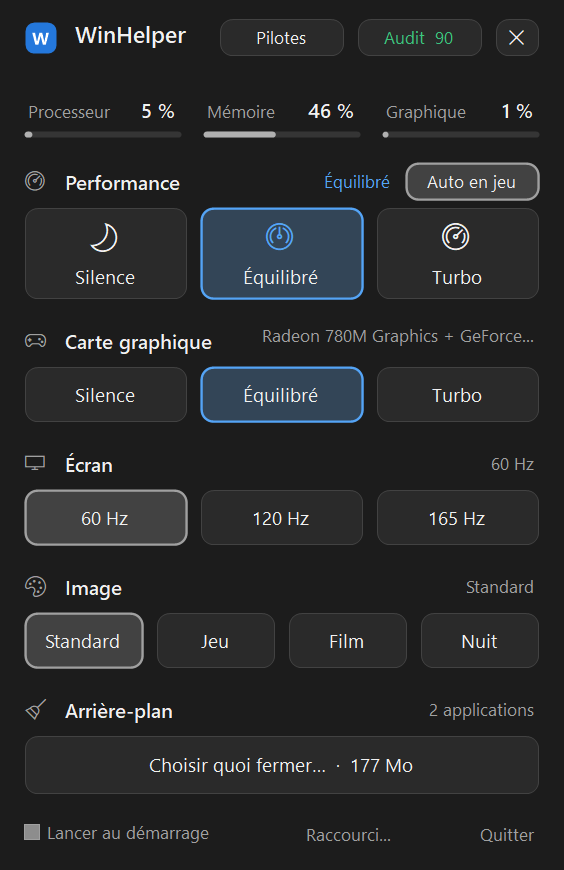

# WinHelper

Un petit panneau de contrôle pour Windows, pensé pour jouer : modes de performance, carte graphique, fréquence d'écran, rendu d'image, pilotes et nettoyage de la mémoire, en un clic. Il fonctionne sur n'importe quel PC, portable ou fixe, quelle que soit la marque.

**[Télécharger WinHelper.exe](https://github.com/badb0ol/WinHelper/releases/latest/download/WinHelper.exe)**

Un seul fichier d'environ 220 Ko. Rien à installer, aucun service en arrière-plan. WinHelper tourne sans droits administrateur ; seuls deux réglages avancés, que vous choisissez vous-même, demandent l'autorisation de Windows.

## Démarrer

1. Téléchargez `WinHelper.exe` et lancez-le.
2. Windows affiche « Windows a protégé votre ordinateur » : l'application n'est pas encore signée. Cliquez sur **Informations complémentaires**, puis **Exécuter quand même**.
3. Au premier lancement, choisissez la touche qui affichera le panneau (par exemple `Ctrl+Alt+W`). Vous pouvez la changer à tout moment en cliquant dessus en bas du panneau.

Le panneau s'ouvre en bas à droite de l'écran, au-dessus des autres fenêtres. La croix le range dans la zone de notification ; votre touche ou un clic sur l'icône le fait revenir.

## Ce que fait le panneau

| Section | Ce que ça change |
|---|---|
| **Mesures** | Charge et température du processeur et de la carte graphique, mémoire utilisée |
| **Batterie** | Niveau, consommation, temps restant et usure de la batterie (portables) |
| **Performance** | Silence, Équilibré ou Turbo : mode d'alimentation de Windows et boost du processeur, avec un mode pour le secteur et un pour la batterie. « Auto en jeu » passe en Turbo le temps d'une partie |
| **Carte graphique** | Silence (60 images/s), Équilibré (vos réglages habituels) ou Turbo, avec une carte NVIDIA ou AMD. « Dédiée en jeu » fait tourner les jeux sur la carte dédiée, sur les PC qui en ont deux |
| **Écran** | Fréquence d'affichage de chaque écran branché. Sur un portable, « Auto » baisse la fréquence sur batterie et la remonte sur secteur |
| **Image** | Standard, Jeu (ombres éclaircies), Film et Nuit (couleurs plus chaudes) |
| **Arrière-plan** | Liste des applications qui tournent en fond ; vous cochez celles à fermer. Sur un portable, « Éco sur batterie » les met en mode efficacité |
| **Pilotes** | Pilotes installés, mises à jour proposées par Windows Update, et nouvelle version de WinHelper |
| **Audit** | Vérifie les oublis classiques : profil mémoire XMP/EXPO, écran sous sa fréquence maximale, écran branché sur la carte mère, etc. |

## Bon à savoir

- **WinHelper rend ce qu'il change.** Les modes s'appliquent tant que WinHelper tourne. Quand vous le quittez ou éteignez le PC, Windows et le pilote graphique retrouvent leurs réglages d'avant ; le mode choisi revient au lancement suivant. Cochez « Lancer au démarrage » pour le garder en permanence.
- **Turbo automatique en jeu.** Quand un jeu démarre, WinHelper passe en Turbo, puis revient à votre mode quand vous le quittez. Sur batterie, rien ne change. Le bouton « Auto en jeu » l'active ou le coupe.
- **Un mode pour le secteur, un pour la batterie.** Le mode choisi sur batterie revient quand vous débranchez, celui du secteur quand vous rebranchez.
- **Une couleur par mode.** Vert pour Silence, bleu pour Équilibré, rouge pour Turbo. L'icône de la zone de notification prend la couleur du mode en cours et allume une, deux ou trois barres.
- **Touche de mode.** Un clic droit sur l'icône de la zone de notification, puis « Touche de mode », permet de choisir une touche qui passe d'un mode au suivant. Panneau fermé, une bulle indique le mode pris.
- **Jeux sur la carte dédiée.** Sur un PC à deux cartes graphiques, chaque jeu reconnu est réglé dans Windows pour utiliser la carte dédiée, à partir de son prochain lancement. Un choix que vous avez déjà fait dans les paramètres graphiques de Windows est respecté. Ce réglage est retiré quand vous quittez WinHelper.
- **Éco sur batterie.** Sur batterie, les applications de fond connues (synchronisation de fichiers, lanceurs, utilitaires) passent en mode efficacité, comme dans le Gestionnaire des tâches. Rien n'est fermé. Les appels, la musique, les logiciels de souris et de clavier et les applications ouvertes à l'écran ne sont pas concernés. Tout revient à la normale sur secteur.
- **Clair ou sombre.** WinHelper suit le thème de Windows. Un clic droit sur l'icône de la zone de notification, puis « Thème », permet de choisir clair ou sombre.
- **Rien ne se ferme sans votre accord.** Le bouton Arrière-plan ouvre une liste ; seules les applications cochées sont fermées, et jamais une application dont une fenêtre est ouverte à l'écran. Chaque application est prévenue avant d'être fermée : si elle refuse parce qu'elle a un travail en cours, elle reste ouverte.
- **Carte graphique.** Les modes fonctionnent avec les cartes NVIDIA et AMD (pilote Adrenalin récent). Turbo privilégie les performances maximales chez NVIDIA et active Radeon Anti-Lag chez AMD. Les réglages que vous avez faits vous-même dans le logiciel NVIDIA ou AMD sont conservés. Les cartes Intel ne sont pas encore prises en charge.
- **Pilotes.** « À jour » signifie que Windows Update ne propose rien de plus récent. Le fabricant peut publier une version plus récente sur son site ; un pilote graphique de plus d'un an est signalé avec le lien vers cette page.
- **Réglages avancés.** Un clic droit sur l'icône de la zone de notification, puis « Réglages avancés » :
  - **Planification GPU accélérée** : la carte graphique gère elle-même la file d'images. Un peu moins de latence, et elle est nécessaire à la génération d'images DLSS 3 et FSR 3.
  - **Captures de la Game Bar coupées** : Windows n'enregistre plus vos parties et ne les surveille plus pour pouvoir le faire. Le gain est modeste.
  - **Intégrité de la mémoire coupée** : quelques pour cent de plus en jeu, mais Windows ne bloque plus certains pilotes malveillants. À réserver à un PC personnel ; si un jeu ou son anti-triche la réclame, réactivez-la.

  La planification GPU et l'intégrité de la mémoire demandent l'autorisation de Windows (administrateur) et ne prennent effet qu'au redémarrage. WinHelper ne se relance en administrateur que le temps d'écrire ce réglage. Ces trois réglages restent en place quand vous quittez WinHelper : décochez-les pour revenir en arrière. Sur un PC géré par une entreprise, ils peuvent être bloqués.
- **Températures.** Elles s'affichent quand Windows les fournit, ce qui dépend du PC. La vitesse des ventilateurs n'est pas affichée : la lire demande un pilote système, que WinHelper n'installe pas.
- **Vie privée.** WinHelper n'envoie rien. Il se connecte seulement à Windows Update, quand la page Pilotes interroge le service de Windows, et à GitHub, pour savoir si une nouvelle version de WinHelper est publiée. Ces vérifications se font à l'ouverture de la page Pilotes, et au plus une fois par semaine.
- Vos choix sont gardés dans `%AppData%\WinHelper\settings.json`.

## Configuration requise

Windows 10 ou 11, 64 bits. Le .NET Framework 4.8 nécessaire est déjà présent sur ces versions de Windows.

## Licence

WinHelper est un logiciel propriétaire, distribué gratuitement. Voir [LICENSE.md](LICENSE.md).
